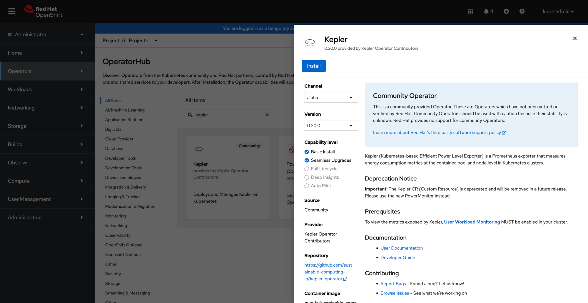
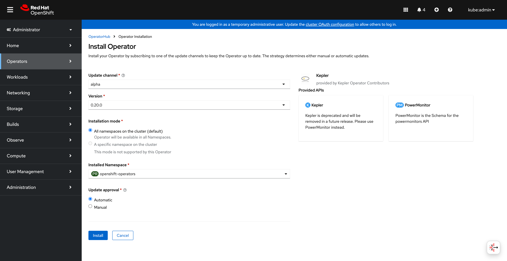
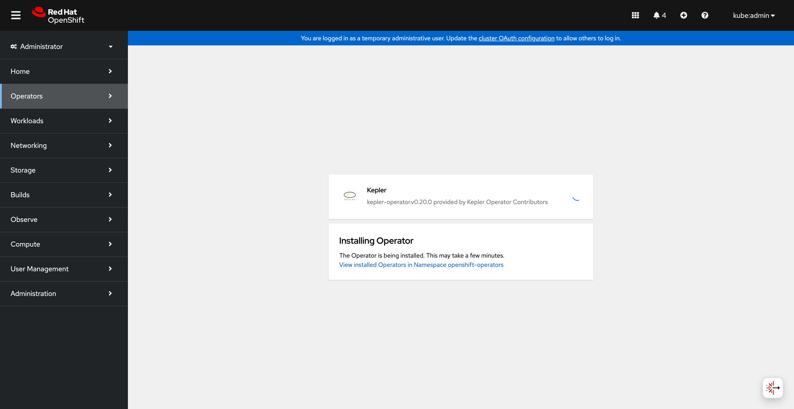
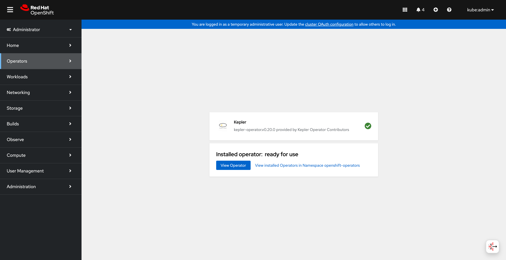
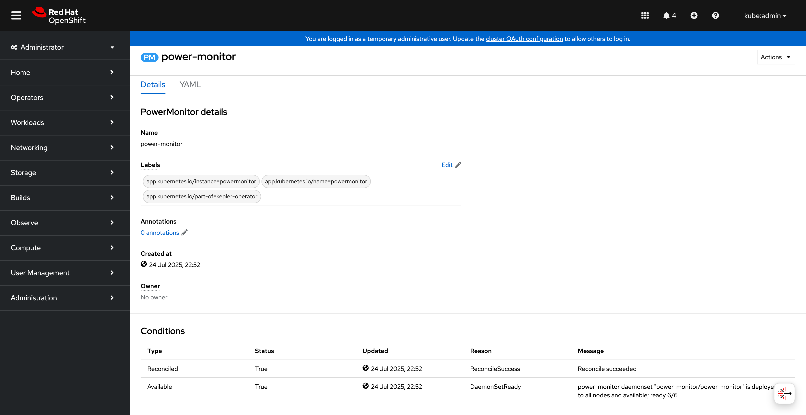
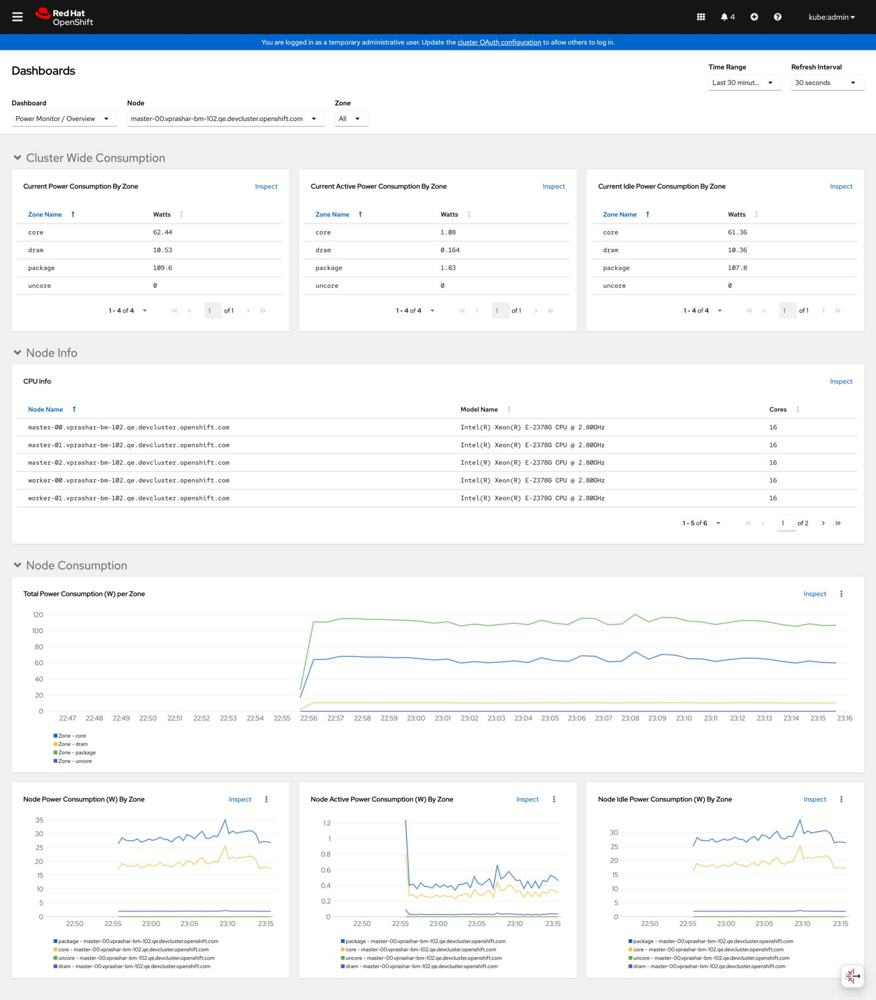
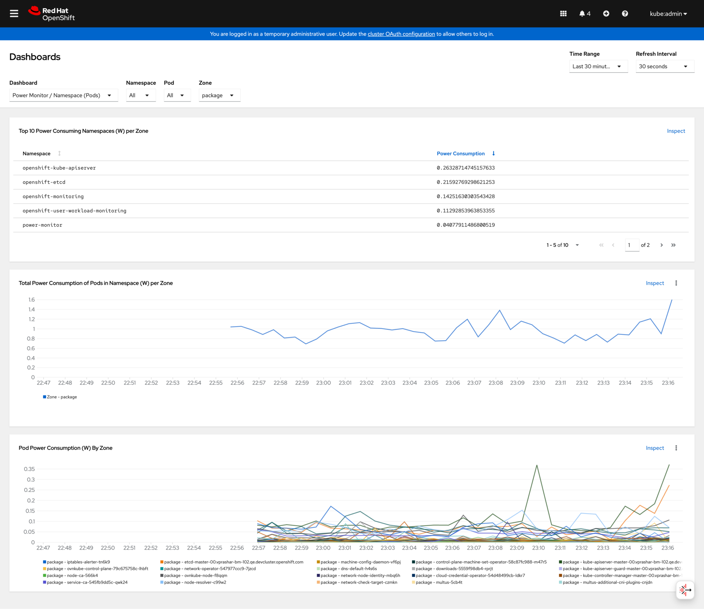

# Installing Kepler Operator on OpenShift

This guide walks you through installing the Kepler Operator on OpenShift using OperatorHub or the Community Catalog.

## Prerequisites

- **OpenShift cluster** running version 4.x or higher
- **oc CLI** or access to the OpenShift Web Console
- Appropriate cluster permissions to install operators

### Built-in OpenShift Features

Unlike vanilla Kubernetes, OpenShift includes several features out-of-the-box that simplify Kepler deployment:

- **Service Serving Certificates**: Automatic TLS certificate management (no cert-manager required)
- **Prometheus Operator**: Built-in monitoring stack
- **User Workload Monitoring**: Optional monitoring for user applications

## Installation via OpenShift Web Console (Recommended)

The screenshots were captured with operator 0.20.0. Console layout can differ
with your installed version; use the current manifests and instructions below.

### Step 1: Navigate to OperatorHub

1. Log in to the OpenShift Web Console
2. Navigate to **Operators** → **OperatorHub**
3. In the search box, type "Kepler Operator"



### Step 2: Install the Operator

1. Click on the **Kepler Operator** tile
2. Click **Install**
3. Configure installation options:
   - **Update channel**: Select `alpha` (or the latest stable channel)
   - **Installation mode**: **All namespaces on the cluster**, the mode supported by the operator's CSV
   - **Installed Namespace**: Select `openshift-operators` (recommended) or create a custom namespace
   - **Update approval**: Choose automatic or manual updates



1. Click **Install**



### Step 3: Verify Installation

1. Navigate to **Operators** → **Installed Operators**
2. Ensure the namespace filter shows your selected namespace (e.g., `openshift-operators`)
3. Verify **Kepler Operator** appears with status **Succeeded**



The operator is now ready to manage PowerMonitor resources.

## Installation via CLI

### Using operator-sdk

If you prefer command-line installation, you can use the `operator-sdk` tool:

```bash
# Install the operator-sdk if not already installed
# See https://sdk.operatorframework.io/docs/installation/

# Run the operator bundle
operator-sdk run bundle \
  quay.io/sustainable_computing_io/kepler-operator-bundle:latest \
  --install-mode AllNamespaces \
  --namespace openshift-operators
```

### Using OLM Subscription (Advanced)

Create a Subscription resource manually:

```yaml
apiVersion: operators.coreos.com/v1alpha1
kind: Subscription
metadata:
  name: kepler-operator
  namespace: openshift-operators
spec:
  channel: alpha
  name: kepler-operator
  source: community-operators
  sourceNamespace: openshift-marketplace
  installPlanApproval: Automatic
```

Apply the subscription:

```bash
oc apply -f kepler-operator-subscription.yaml
```

Complete the [installation verification](#verification) before creating a
PowerMonitor. Continue after the installed Kepler CSV reports `Succeeded` and
the PowerMonitor CRD is available.

## Create a PowerMonitor

Before continuing, enable [User Workload Monitoring](#integration-with-openshift-monitoring)
if it is not already enabled, and confirm its service account exists:

```bash
oc get serviceaccount prometheus-user-workload -n openshift-user-workload-monitoring
```

If the service account is missing, wait for User Workload Monitoring to finish
starting before continuing. The default OpenShift RBAC configuration requires
this service account for PowerMonitor reconciliation.

### Using the Console

1. Open **Operators → Installed Operators → Kepler Operator**.
2. Select the **PowerMonitor** tab and click **Create PowerMonitor**.
3. Switch to YAML view and use the manifest below. The name must be
   `power-monitor`; PowerMonitor is a cluster-scoped singleton.

### Using YAML or the CLI

Save this as `power-monitor.yaml`, or paste it into the console YAML editor:

```yaml
apiVersion: kepler.system.sustainable.computing.io/v1alpha1
kind: PowerMonitor
metadata:
  name: power-monitor
spec:
  kepler:
    deployment:
      nodeSelector:
        kubernetes.io/os: linux
    config:
      logLevel: info
      metricLevels: [node, pod, vm]
      sampleRate: 5s
      staleness: 500ms
```

For CLI installation, validate and apply it:

```bash
oc apply --dry-run=server -f power-monitor.yaml
oc apply -f power-monitor.yaml
pm_generation=$(oc get powermonitor power-monitor -o jsonpath='{.metadata.generation}')
oc wait \
  --for=jsonpath='{.status.conditions[?(@.type=="Reconciled")].observedGeneration}'="$pm_generation" \
  powermonitor/power-monitor --timeout=180s
oc wait --for=condition=Reconciled powermonitor/power-monitor --timeout=180s
oc rollout status daemonset/power-monitor -n power-monitor --timeout=180s
oc get powermonitor power-monitor -o yaml
oc get pods -n power-monitor -o wide
```

The component namespace defaults to `power-monitor`; substitute your operator's
`--deployment-namespace` value if customized. If a wait times out, check
PowerMonitor conditions and events before continuing.



See [PowerMonitor configuration](../reference/power-monitor.md) for additional
settings and [uninstallation](../reference/uninstallation.md) for removal.

## Verification

### Check Subscription Status

```bash
oc get subscription kepler-operator -n openshift-operators
```

### Check Operator Status

Verify the operator is running:

```bash
oc get pods -n openshift-operators | grep kepler-operator
```

Expected output:

```text
kepler-operator-controller-xxxxx-yyyyy  2/2   Running  0  1m
```

### Check ClusterServiceVersion (CSV)

```bash
oc get csv -n openshift-operators | grep kepler
```

You should see the Kepler Operator CSV with `Succeeded` phase:

```text
kepler-operator.v0.21.0   Kepler Operator   0.21.0   Succeeded
```

### Check Custom Resource Definitions

Verify the PowerMonitor CRD is installed:

```bash
oc get crd powermonitors.kepler.system.sustainable.computing.io
```

## OpenShift-Specific Features

### Security Context Constraints (SCC)

Kepler needs host access to hardware sensors and process information. The operator manages the `power-monitor` Security Context Constraints (SCC), allowing host paths, host PID access, and the `SYS_PTRACE` capability. Kepler containers run with `privileged: false`.

You can verify the SCC configuration:

```bash
oc get scc power-monitor
oc describe scc power-monitor
```

### Integration with OpenShift Monitoring

Kepler integrates with OpenShift monitoring through ServiceMonitor resources. With the default RBAC security mode, the exporter ServiceMonitor requires the User Workload Monitoring service account in `allowedSANames`; see [Prometheus integration](../guides/validating-prometheus-integration.md).

To enable User Workload Monitoring (if not already enabled):

```bash
oc apply -f - <<EOF
apiVersion: v1
kind: ConfigMap
metadata:
  name: cluster-monitoring-config
  namespace: openshift-monitoring
data:
  config.yaml: |
    enableUserWorkload: true
EOF
```

## Next Steps

Now that the operator is installed:

1. **[Configure PowerMonitor](../reference/power-monitor.md)** for your cluster
2. **[Set up Grafana dashboards](../guides/grafana-dashboard.md)** to visualize energy metrics

### View the OpenShift Dashboards

With User Workload Monitoring enabled and scraping Kepler, open
**Observe → Dashboards**. Select **Power Monitor / Overview** for node metrics
or **Power Monitor / Namespace (Pods)** for pod metrics.





Use **Observe → Metrics** for PromQL queries, for example
`kepler_node_cpu_watts{job="power-monitor"}`. For direct diagnostics, run
`oc port-forward -n power-monitor daemonset/power-monitor 28282:28282` and query
`http://localhost:28282/metrics` in another terminal. This forwards the exporter
port locally; the RBAC-protected Service uses HTTPS port `8443`.

## Troubleshooting

### Operator Not Appearing in OperatorHub

If Kepler Operator doesn't appear in OperatorHub:

1. Check if the Community Operators catalog source is enabled:

   ```bash
   oc get catalogsource -n openshift-marketplace
   ```

2. Look for `community-operators` in the list. If missing, contact your cluster administrator.

### Installation Stuck in "Installing" State

Check the install plan status:

```bash
oc get installplan -n openshift-operators
oc describe installplan <install-plan-name> -n openshift-operators
```

### CSV Failures

View CSV details to understand failures:

```bash
oc describe csv kepler-operator.v<version> -n openshift-operators
```

Check operator logs:

```bash
oc logs -n openshift-operators deployment/kepler-operator-controller
```

For more detailed troubleshooting, see the [Troubleshooting Guide](../guides/troubleshooting.md#openshift-specific-issues).

## Upgrading

OpenShift operators can be upgraded automatically or manually based on your installation configuration.

See the [Upgrading Guide](../guides/upgrading.md#upgrading-on-openshift-olm) for details.

## Uninstallation

To uninstall Kepler Operator from OpenShift, see the [Uninstallation Guide](../reference/uninstallation.md#uninstalling-via-olm-openshift).
